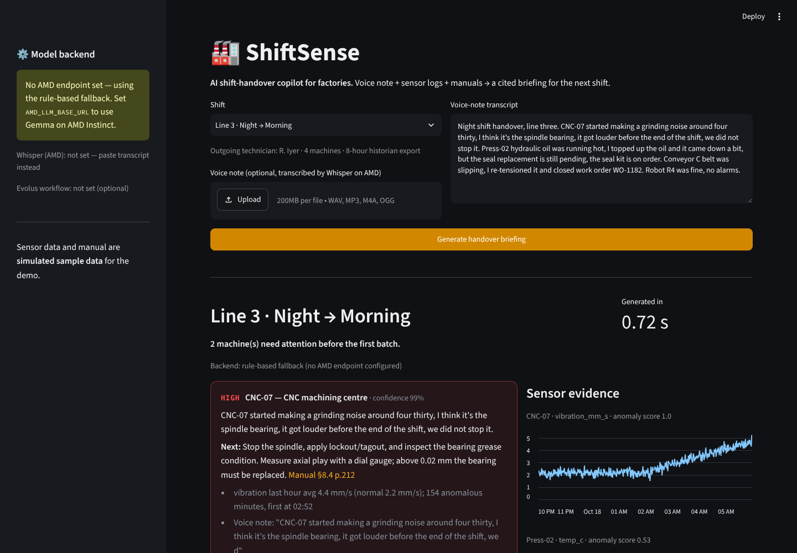

# 🏭 ShiftSense — AI shift-handover copilot for factories

**AMD Developer Hackathon: ACT III · Track: Intelligent Industry**

Every 8 hours a factory changes shift, and knowledge gets lost: a noisy spindle, a temporary fix, a part on order. ShiftSense turns the outgoing technician's voice note, the shift's sensor logs and the maintenance manual into a **cited briefing for the incoming shift** — which machines are at risk and why, what was done, what is still open, the manual page to open, and which items a supervisor must sign off.



## How it works

```
voice note ──► Whisper (vLLM on AMD Instinct, ROCm) ──► transcript ─┐
sensor logs ─► IsolationForest anomaly scoring per machine ─────────┼─► Gemma (vLLM on AMD Instinct) ─► briefing JSON ─► UI / Evolus workflow
manuals ─────► TF-IDF retrieval of the matching manual section ─────┘                 │
                                                                          enforced safety rule: lockout / pressure /
                                                                          guarding / leak items always escalate
```

| Step | Component | Runs on |
|---|---|---|
| Speech → text | `openai/whisper-large-v3` served by vLLM | AMD Instinct GPU, ROCm (AMD Developer Cloud) |
| Risk scoring | scikit-learn IsolationForest per machine (numbers, not LLM guesses) | app server |
| Retrieval | TF-IDF over manual sections | app server |
| Briefing | `google/gemma-3-12b-it` served by vLLM (OpenAI-compatible API) | AMD Instinct GPU, ROCm (AMD Developer Cloud) |
| Distribution (optional) | Evolus workflow via REST API | Evolus |

**Responsible by design:** every item shows its evidence (sensor window, voice-note quote, manual reference) and a confidence; safety-related, high-risk and low-confidence items are escalated to a supervisor, and this rule is enforced in code outside the model. If the model endpoint is down, a deterministic rule-based fallback keeps the briefing available.

## Run it

### 1. Serve the models on AMD Developer Cloud
On an AMD Instinct GPU droplet with ROCm:
```bash
export HF_TOKEN=...        # Gemma is gated on Hugging Face
export VLLM_API_KEY=...    # any secret string
./scripts/serve_on_amd.sh
```
(Alternatively point `AMD_LLM_BASE_URL` at any OpenAI-compatible AMD-hosted endpoint, e.g. the event's token factory.)

### 2. Run the app
```bash
cp .env.example .env   # fill in your endpoint
pip install -r requirements.txt
set -a && source .env && set +a
streamlit run app.py
```
or with Docker:
```bash
docker build -t shiftsense . && docker run -p 8501:8501 --env-file .env shiftsense
```
On Streamlit Community Cloud, put the same variables in **App settings → Secrets** (TOML, e.g. `AMD_LLM_BASE_URL = "http://..."`).

Without any environment variables the app still runs, using the rule-based fallback — the sidebar shows which backend is active.

## Environment variables
| Variable | Purpose |
|---|---|
| `AMD_LLM_BASE_URL`, `AMD_LLM_API_KEY`, `AMD_LLM_MODEL` | Gemma endpoint on AMD (vLLM) |
| `AMD_WHISPER_BASE_URL`, `AMD_WHISPER_MODEL` | Whisper endpoint on AMD (optional, for audio upload) |
| `EVOLUS_API_KEY`, `EVOLUS_APP_ID`, `EVOLUS_WORKFLOW_ID` | Optional Evolus workflow that receives the briefing |

## Project structure
```
app.py                  Streamlit UI (tablet-friendly)
shiftsense_core.py      anomaly scoring, retrieval, transcription, briefing (LLM + fallback)
shiftsense_evolus.py    optional Evolus workflow hand-off
data/manual.md          sample maintenance manual (fictional)
scripts/serve_on_amd.sh vLLM + ROCm serving for Gemma and Whisper
```

## Demo data
Two scenarios are included: **Line 3 Night → Morning** (spindle bearing wear on CNC-07, hydraulic overheating on Press-02) and **Line 1 Day → Evening** (conveyor jam, robot joint current spikes). Sensor data is simulated per-minute historian data and the manual is fictional; both are clearly marked in the app.

## Roadmap
Connect real historian (OPC UA / MQTT) and CMMS work orders · multilingual voice notes on the floor · on-prem deployment on AMD hardware.

## License
MIT
